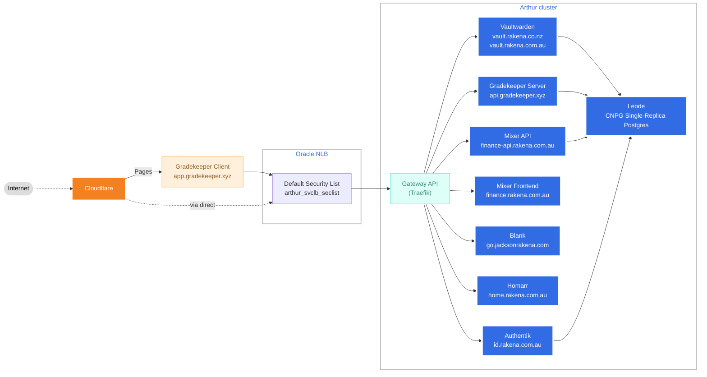

# Jackson's Cloud Infrastructure



This repository describes everything running on my self-hosted Kubernetes cluster (Arthur, on Oracle Cloud's free tier) as [helmfile](https://helmfile.readthedocs.io/) releases: upstream Helm charts for third-party software, small local charts for everything else, and one SOPS-encrypted file for every secret.

I do not intend for this repository to be used by anyone else (but feel free to use it as examples/learning), but if you do, you'll need to replace the secrets with your own.

## Layout

| Path | What it is |
| ---- | ---------- |
| `helmfile.yaml.gotmpl` | Every release, its chart version, namespace and dependencies (`needs`) |
| `values/<release>.yaml` | Non-secret configuration for each release |
| `environments/prod/secrets.sops.yaml` | Every secret, encrypted with [SOPS](https://github.com/getsops/sops) + [age](https://age-encryption.org) |
| `charts/` | Local charts: `app` (generic web app), `data`, `secrets`, `gateway`, `cluster-config`, `gateway-api-crds`, `tailscale-crds`, `tailscale-config` |
| `scripts/diff.sh` | Previews changes against the cluster (`make diff`) |

## Releases

Releases are grouped into tiers (helmfile label `tier`) and installed in dependency order.

| Tier | Release | Chart | Namespace | Notes |
| ---- | ------- | ----- | --------- | ----- |
| platform | `gateway-api-crds` | local (vendored upstream v1.6.1) | — | Gateway API standard CRDs |
| platform | `cluster-config` | local | — | Namespaces and the OCI block volume storage classes |
| platform | `cnpg` | [`cloudnative-pg`](https://github.com/cloudnative-pg/charts) | `cnpg-system` | CloudNativePG operator and CRDs |
| platform | `traefik` | [`traefik`](https://github.com/traefik/traefik-helm-chart) | `traefik` | Gateway API controller, `GatewayClass`, and the Oracle Network Load Balancer |
| platform | `tailscale-crds` | local (vendored from `tailscale-operator`) | — | Tailscale CRDs, with the keep policy the upstream chart lacks |
| platform | `tailscale-operator` | [`tailscale-operator`](https://tailscale.com/kb/1236/kubernetes-operator) | `tailscale` | Tailscale operator (`installCRDs: false`) |
| platform | `tailscale-config` | local | `tailscale` | The `mel-arthur-exit` exit node `Connector` |
| secrets | `secrets` | local | `prod` | Every Secret, rendered from the SOPS file |
| data | `data` | local | `prod` | `arthur-global-data` volume, the `leode` Postgres cluster, its roles and databases |
| edge | `gateway` | local | `prod` | The public `Gateway`, terminating TLS for `rakena.co.nz`, `rakena.com.au` and `jacksonrakena.com` |
| apps | `vaultwarden` | local `app` | `prod` | [dani-garcia/vaultwarden](https://github.com/dani-garcia/vaultwarden) at vault.rakena.com.au, vault.rakena.co.nz |
| apps | `homarr` | local `app` | `prod` | [homarr-labs/homarr](https://github.com/homarr-labs/homarr) at home.rakena.com.au |
| apps | `gradekeeper` | local `app` | `prod` | [Gradekeeper](https://github.com/jacksonrakena/gradekeeper) API at api.gradekeeper.xyz |
| apps | `mixer-api`, `mixer-frontend` | local `app` | `prod` | [Mixer](https://github.com/jacksonrakena/mixer) at finance-api.rakena.com.au, finance.rakena.com.au |
| apps | `blank` | local `app` | `prod` | [Blank](https://github.com/jacksonrakena/blank) at go.jacksonrakena.com |
| apps | `authentik` | [`authentik`](https://github.com/goauthentik/helm) | `prod` | [Authentik](https://goauthentik.io) at id.rakena.com.au |
| platform | `prometheus-operator-crds` | [`prometheus-operator-crds`](https://github.com/prometheus-community/helm-charts) | — | Prometheus Operator CRDs, with the keep policy |
| monitoring | `monitoring` | [`kube-prometheus-stack`](https://github.com/prometheus-community/helm-charts/tree/main/charts/kube-prometheus-stack) | `monitoring` | Prometheus, Grafana at monitoring.rakena.com.au, kube-state-metrics, node-exporter |
| monitoring | `cnpg-dashboard` | [`cnpg-grafana/cluster`](https://github.com/cloudnative-pg/grafana-dashboards) | `monitoring` | CloudNativePG dashboard for Grafana |

Each app owns its `HTTPRoute`s (`routes:` in its values file). Vaultwarden and Homarr use the local `app` chart because Vaultwarden has no official chart, and Homarr's chart can't mount a subPath of the shared volume, which is where its data lives.

### Cluster-critical resources

Anything whose deletion would lose data or break the cluster carries `helm.sh/resource-policy: keep`, so uninstalling or renaming a release never deletes it: every CRD, the namespaces, the storage classes, the `arthur-global-data` volume claim and the `leode` Cluster. Removing one of these from a chart leaves it on the cluster; delete it by hand if that is really intended.

Everything else is pruned normally: when a template stops rendering an object, Helm deletes it on the next `make apply`.

### Load balancer

Traefik serves HTTPS only, through a `LoadBalancer` Service annotated `oci.oraclecloud.com/load-balancer-type: nlb`, so Oracle provisions a free-tier Network Load Balancer rather than a (paid) Load Balancer. Traefik and Gateway API do everything the OCI Load Balancer would. The Service pins the reserved public IP `158.179.25.151` and node port `32700` (`values/traefik.yaml`); edit these for another environment.

Gateway listeners use port `8443`, Traefik's `websecure` entrypoint (container) port, which the Service publishes as 443.

### Monitoring

Prometheus scrapes every `ServiceMonitor` and `PodMonitor` in the cluster, including Leode and the CloudNativePG operator. Grafana is at monitoring.rakena.com.au, with the kube-prometheus-stack dashboards and the [CloudNativePG dashboard](https://github.com/cloudnative-pg/grafana-dashboards) (`cnpg-dashboard` release).

- **Grafana** stores users, dashboards and settings in its own `grafana` database on Leode (role `grafana`, pool of 5 connections), so they survive restarts.
- **Prometheus** has no persistent volume, because the free-tier block volume budget is used up. It keeps 3 days (at most 3 GB) in an `emptyDir`, so a pod restart loses metrics history.
- Alertmanager is disabled (no receivers), as are the control-plane scrapes OKE doesn't expose.

Sign-in is through Authentik only (`id.rakena.com.au`, OAuth client in SOPS as `grafana.oauth`); Grafana's password form and API basic auth are disabled. Roles follow Authentik groups at each sign-in: `authentik Admins` → Grafana server admin, `Grafana Admins` → Admin, `Grafana Editors` → Editor, everyone else → Viewer.

If Authentik is unavailable, set `auth.disable_login_form: false` in `values/monitoring.yaml`, apply, and sign in as `admin` with `grafana.adminPassword`:

```
sops decrypt --extract '["grafana"]["adminPassword"]' environments/prod/secrets.sops.yaml
```

### Leode

A single CloudNativePG cluster serves every app that needs Postgres (Gradekeeper, Mixer, Authentik, Grafana), with one managed login role and database per app. It runs `instances: 1`: each instance needs its own volume, and the free tier allows 200 GiB of block storage (`arthur-global-data` 50 GiB + 2 node boot volumes at 50 GiB + 1 Leode instance at 50 GiB). For cluster maintenance, scale to 2 instances for failover in `values/data.yaml`, then back to 1.

## Secrets

All secrets are in `environments/prod/secrets.sops.yaml`. Keys are readable, values are encrypted to the age recipients in `.sops.yaml`. Decryption happens in exactly one place, `values/secrets.yaml.gotmpl`, which turns the file into Kubernetes Secrets (the `secrets` release). App releases only reference those Secrets by name, so no app chart ever handles secret material.

| Key | Becomes | Used by |
| --- | ------- | ------- |
| `tls.<domain>.{crt,key}` | `tls-<domain>` (`kubernetes.io/tls`) | `gateway` listeners |
| `registry.ghcr` | `ghcr-pull` (`kubernetes.io/dockerconfigjson`) | Pulling private images from GitHub Container Registry |
| `postgresRoles.<app>.{username,password}` | `leode-role-<app>` (`kubernetes.io/basic-auth`); Grafana's also as `monitoring/grafana-db` | Leode managed roles, and each app's database login |
| `env.<app>` | `<app>-env`, loaded as environment variables | `vaultwarden`, `gradekeeper`, `mixer` (API), `homarr` (`SECRET_ENCRYPTION_KEY`), `authentik` (`AUTHENTIK_SECRET_KEY`) |
| `blankTargets` | ConfigMap `blank-targets` (`targets.kdl`) | Blank's redirect targets |
| `tailscaleOAuth.{client_id,client_secret}` | `tailscale/operator-oauth` | Tailscale operator |
| `grafana.adminPassword` | `monitoring/grafana-admin` | Grafana `admin` login (break-glass only) |
| `grafana.oauth.{clientId,clientSecret}` | `monitoring/grafana-oauth` | Grafana's Authentik OAuth client |

Edit with `make secrets`, which opens the decrypted file in `$EDITOR` and re-encrypts on save. Then `make apply SELECTOR=name=secrets`. Pods read env-var Secrets at startup, so restart the app afterwards (`kubectl rollout restart -n prod deployment/<app>`). Leode picks up role password changes automatically.

The age private key is at `~/Library/Application Support/sops/age/keys.txt` (macOS; `~/.config/sops/age/keys.txt` on Linux). **Back it up**: without it the secrets can't be decrypted. To add another key (a second machine, a backup key), add its public key to `.sops.yaml` and run `sops updatekeys environments/prod/secrets.sops.yaml`.

## Recipes

Install the pinned tooling (kubectl, helm, helmfile, sops, age) with `mise install`. No Helm plugins are needed.

#### Preview changes

```
make diff
make diff SELECTOR=tier=apps
```

Renders each release and shows what server-side apply would change on the cluster (Secret values are masked). It doesn't show objects Helm would delete because they were removed from a chart.

#### Apply

```
make apply                          # everything, in dependency order
make apply SELECTOR=name=mixer-api  # one release (any helmfile selector)
```

#### Upgrade an upstream chart

Bump `version:` for the release in `helmfile.yaml.gotmpl`, `make diff SELECTOR=name=<release>`, then apply. For the Gateway API CRDs, run `scripts/vendor-gateway-api.sh <version>` and bump `charts/gateway-api-crds/Chart.yaml`. For Tailscale, run `scripts/vendor-tailscale-crds.sh <version>`, bump `charts/tailscale-crds/Chart.yaml`, and keep the `tailscale-operator` release on the same version.

#### Add an app

Add a release that inherits the `app` template in `helmfile.yaml.gotmpl`, write `values/<name>.yaml` (image, port, env, `routes:`), and add any secrets under `env.<name>` with `make secrets`.

## Copyright

**&copy; 2023&mdash;2026 Jackson Rakena**  
Use is permitted for educational and personal purposes only.  
Commercial use is forbidden without written consent of the project author.
